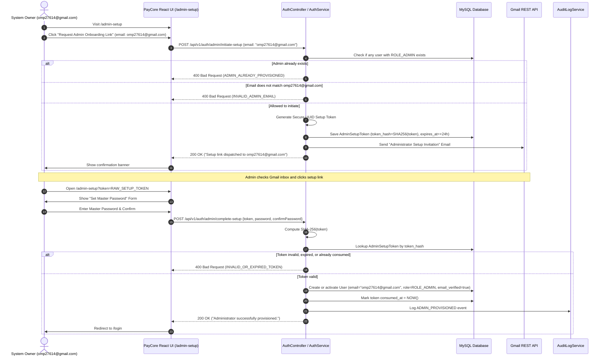

# PayCore — Initial Administrator Onboarding & Provisioning Architecture

## 1. Zero-Trust Admin Provisioning Overview

In production payment systems, administrative accounts possess high-privilege access: inspecting merchant ledgers, resolving reconciliation discrepancies, managing webhook endpoints, and auditing audit trails.

To ensure zero-trust security:
1. **No Hardcoded Admin Passwords:** Production code and seed scripts contain no pre-set administrative passwords.
2. **Strict Email Identity Binding:** Initial administrator setup is strictly bound to the verified system owner email: `omp27614@gmail.com`.
3. **No Public Admin Registration:** The public `/api/v1/auth/register` endpoint strictly assigns `ROLE_MERCHANT`. Administrative roles cannot be registered through public forms.
4. **Email-Proof Required:** An admin account can only be established after proving control over `omp27614@gmail.com` via a cryptographic token sent through the Gmail API.
5. **One-Time Provisioning Lockout:** Once an administrator is provisioned, the initial onboarding flow is permanently locked out. Subsequent administrators can only be created by an authenticated administrator.

---

## 2. Admin Setup Sequence Diagram



---

## 3. Database Schema: `admin_setup_tokens`

```sql
CREATE TABLE admin_setup_tokens (
    id BIGINT AUTO_INCREMENT PRIMARY KEY,
    user_id BIGINT NOT NULL,
    token_hash VARCHAR(64) NOT NULL UNIQUE,
    expires_at TIMESTAMP NOT NULL,
    consumed_at TIMESTAMP NULL,
    created_at TIMESTAMP NOT NULL DEFAULT CURRENT_TIMESTAMP,
    CONSTRAINT fk_admin_setup_user FOREIGN KEY (user_id) REFERENCES users(id) ON DELETE CASCADE,
    INDEX idx_admin_setup_hash (token_hash)
);
```

---

## 4. Test Environment Isolation

In local and CI automated tests:
- Property `paycore.security.seed-test-admin` is set to `true` **only** in `application-test.properties` so existing integration tests (such as `ReconciliationIntegrationTest` and `AuditIntegrationTest`) can execute against a dummy admin (`admin@paycore.internal`).
- In `application.properties` (production), `paycore.security.seed-test-admin` defaults to `false`.
- In `AuthIntegrationTest`, the flag is explicitly tested as `false` to verify that real admin onboarding operates properly without test artifacts.
