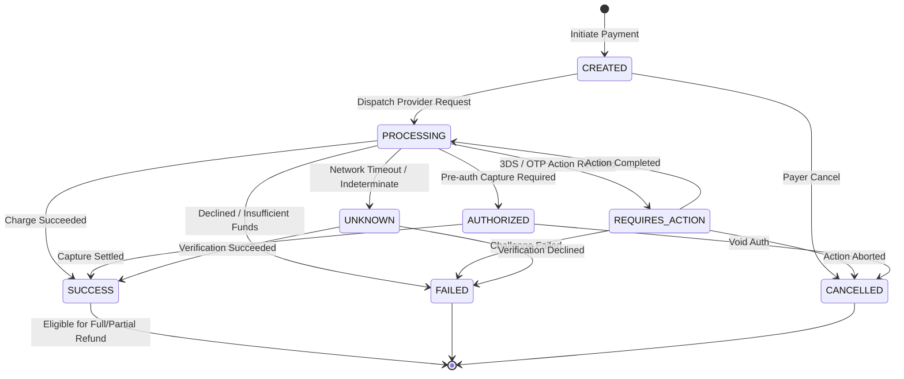
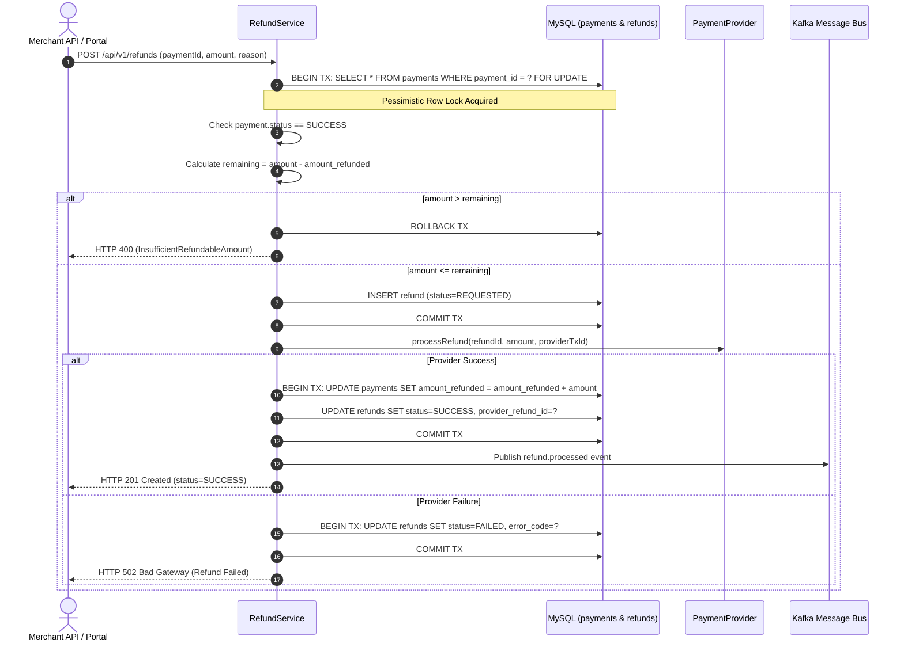

# PAYCORE — APPLICATION FLOWS & STATE MACHINES

## 1. Payment Lifecycle State Machine

The payment lifecycle is governed by an explicit finite state machine. Arbitrary status updates are rejected.

### 1.1 State Definitions
- **`CREATED`**: Payment intent received and recorded in internal database with unique `payment_id`. Downstream provider not yet invoked.
- **`PROCESSING`**: Charge invocation dispatched to downstream payment provider.
- **`REQUIRES_ACTION`**: Additional authentication required (e.g. 3D Secure redirect or OTP challenge).
- **`AUTHORIZED`**: Funds reserved on customer's account but not yet captured (for two-step charge workflows).
- **`SUCCESS`**: Charge successfully captured and settled. Terminal state for payment (can now be refunded).
- **`FAILED`**: Charge declined by card network, insufficient funds, or fatal error. Terminal state.
- **`CANCELLED`**: Transaction cancelled by payer or merchant prior to capture. Terminal state.
- **`UNKNOWN`**: Network timeout or indeterminate provider response. Requires verification or reconciliation before attempting any further charge.

### 1.2 State Transition Matrix

```
Current Status   │ Allowed Next Statuses                   │ Trigger / Event
─────────────────┼─────────────────────────────────────────┼─────────────────────────────────────────
CREATED          │ PROCESSING, CANCELLED                   │ Dispatch to provider / User cancels
PROCESSING       │ REQUIRES_ACTION, AUTHORIZED, SUCCESS,   │ Provider responds or network times out
                 │ FAILED, UNKNOWN                         │
REQUIRES_ACTION  │ PROCESSING, FAILED, CANCELLED           │ Payer completes 3DS challenge or cancels
AUTHORIZED       │ SUCCESS, CANCELLED                      │ Capture request / Void authorization
SUCCESS          │ (Terminal - Eligible for Refund)        │ -
FAILED           │ (Terminal)                              │ -
CANCELLED        │ (Terminal)                              │ -
UNKNOWN          │ SUCCESS, FAILED                         │ Reconciliation / Explicit Provider Query
```

### 1.3 State Diagram



---

## 2. Core Operational Application Flows

### 2.1 Payment Initiation & Idempotency Check Flow

```
1. Client sends POST /api/v1/payments with:
   - Header: X-Api-Key (Merchant Secret Key)
   - Header: Idempotency-Key (UUID or client-chosen key)
   - Body: { orderId, amount, currency, paymentMethod, customerEmail, ... }

2. Authentication Filter validates X-Api-Key:
   - Hashes key with SHA-256 and finds matching active key in `merchant_api_keys`.
   - Identifies `merchant_id`.

3. Idempotency Engine checks key:
   - Computes request hash: SHA-256(Method + Path + Body).
   - Attempts Redis distributed lock: `lock:idempotency:{merchant_id}:{key}`.
   - If lock fails: Return HTTP 409 Conflict (Concurrent request in flight).
   - Checks `idempotency_records` table in MySQL for `(merchant_id, idempotency_key)`.
   - If record exists:
     - If hash matches: Return cached response immediately (HTTP 200/201).
     - If hash does not match: Return HTTP 422 Unprocessable Entity (Tampered/reused key).

4. Pre-Charge Phase (DB Transaction 1):
   - Generates unique `payment_id` (e.g. `PAY_8F2301`).
   - Inserts record into `payments` table with status = `CREATED`.
   - Commits Transaction 1. (Transaction closes before provider call!)

5. Provider Execution Phase (Non-Transactional Network I/O):
   - Invokes `PaymentProvider.initiateCharge(...)`.
   - Handles Outcome:
     - SUCCESS: Provider returns provider transaction ID.
     - DECLINED: Provider returns failure code (e.g. `INSUFFICIENT_FUNDS`).
     - TIMEOUT: SocketTimeoutException caught after 5000ms.

6. Post-Charge Phase (DB Transaction 2):
   - Opens Transaction 2.
   - Updates `payments` status:
     - SUCCESS -> `SUCCESS`
     - DECLINED -> `FAILED`
     - TIMEOUT -> `UNKNOWN`
   - Inserts `payment_attempts` record with raw sanitized request/response logs.
   - Saves cached response into `idempotency_records`.
   - Releases Redis distributed lock.
   - Commits Transaction 2.

7. Asynchronous Event Phase:
   - Emits Kafka event: `paycore.payment.events` (event_type = `payment.success` or `payment.failed`).
   - Webhook worker consumes event and dispatches signed HTTP webhook to merchant.

8. Return HTTP Response to Client:
   - If SUCCESS: HTTP 201 Created with PaymentResponseDto.
   - If UNKNOWN: HTTP 202 Accepted with status UNKNOWN and advice to poll.
```

---

## 3. Refund Flow & Partial Refund Tracking



---

## 4. Webhook Dispatch & Retry Flow (Stage 6)

```mermaid
flowchart TD
    TX[Business Transaction: Payment/Refund State Transition] -->|Atomic Insert| OB[(outbox_events Table)]
    OB -->|OutboxPublisherScheduler| KP[Kafka Producer: Key=AggregateId]
    KP --> KT[Kafka Topics: paycore.payment.events / paycore.refund.events]
    
    KT --> IC[Idempotent Kafka Consumer]
    IC --> IB{Check inbox_events<br/>(event_id, consumer_name)}
    IB -->|Duplicate Found| IGN[Short-circuit Duplicate / Acknowledge]
    IB -->|First Receipt| WD[Webhook Dispatcher Service]
    
    WD --> EP[Find Active Subscribed Merchant Endpoints]
    EP --> SSRF{Validate Destination URL<br/>WebhookSsrfValidator}
    SSRF -->|Private/Loopback/Redirect| REJ[Reject SSRF & Record Attempt FAILED]
    SSRF -->|Valid Public HTTPS| SIG[Generate HMAC-SHA256 Signature<br/>X-PayCore-Signature: t=...,v1=...]
    
    SIG --> POST[HTTP POST Worker<br/>Timeout: 5000ms]
    POST --> RES{HTTP Response Code}
    
    RES -->|2xx Success| SUC[delivery_status = SUCCESS<br/>Reset Consecutive Failures]
    RES -->|4xx Client Error| CLN[Non-retryable 4xx<br/>delivery_status = FAILED]
    RES -->|5xx Server Error / 429 / Timeout| RET{Attempt < 5?}
    
    RET -->|Yes| SCH[Calculate Backoff: 5s, 30s, 120s, 900s, 3600s<br/>delivery_status = RETRYING<br/>next_retry_at = now + delay]
    SCH --> WR[WebhookRetryScheduler Poller]
    WR --> POST
    
    RET -->|No: 5 Attempts Exhausted| DLQ[delivery_status = DEAD_LETTER<br/>Route to Admin Quarantine]
    DLQ --> ADM[Admin Alert & Manual Replay Available]
```

---

## 5. Daily Settlement Reconciliation Flow

```mermaid
flowchart LR
    A[Trigger: Midnight Cron / Admin Request] --> B[Fetch Internal Payments (SUCCESS in date window)]
    B --> C[Fetch Provider Settlement File / Simulated Feed]
    C --> D[Reconciliation Engine Comparison]
    
    D --> M1[Matched Records: Same ID, Amount, Status]
    D --> M2[Amount Mismatch: Internal != Provider Amount]
    D --> M3[Status Mismatch: e.g. Internal UNKNOWN vs Provider SUCCESS]
    D --> M4[Missing Provider: Present Internally, Missing in Provider]
    D --> M5[Missing Internal: Settled in Provider, Missing Internally]
    
    M1 & M2 & M3 & M4 & M5 --> REP[Generate Reconciliation Batch & Records]
    REP --> DASH[Surface Report on Admin & Merchant Dashboards]
```
