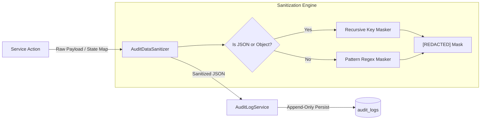

# PayCore — Immutable Audit Logging Design

---

## 1. Overview & Guarantees

The **PayCore Audit Logging Subsystem** provides a tamper-resistant, append-only historical audit trail for financial transactions, operational state changes, administrative actions, and compliance events.

### Core Guarantees:
- **Immutability:** Audit records can only be created via `INSERT`. No `UPDATE` or `DELETE` endpoints, methods, or triggers exist.
- **Automated Data Sanitization:** Sensitive credentials, private keys, authentication tokens, and raw payment card data are permanently redacted before disk persistence.
- **Actor Accountability:** Captures authenticated principal identities, roles, target resource identifiers, state diffs (`before_data`, `after_data`), and justification reasons.
- **Strict Role-Based Access:** Read access is restricted strictly to users with `ROLE_ADMIN`.

---

## 2. Sensitive Data Sanitization Architecture



### Redaction Rules (`AuditDataSanitizer`)

The sanitizer recursively inspects JSON objects and serializable maps. Any key matching known sensitive keywords is stripped of its value and replaced with `"[REDACTED]"`:

- **Authentication & Secrets:** `password`, `passwordHash`, `secret`, `secretKey`, `apiKey`, `key`, `token`, `accessToken`, `refreshToken`, `jwt`, `privateKey`, `clientSecret`, `webhookSecret`.
- **Cardholder Data (PCI-DSS):** `cardNumber`, `pan`, `cvv`, `cvc`, `securityCode`.

---

## 3. Database Schema & Indexing

The `audit_logs` table is optimized for high-volume append operations and fast temporal/resource filtering:

```sql
CREATE TABLE audit_logs (
    id BIGINT AUTO_INCREMENT PRIMARY KEY,
    actor_id VARCHAR(128) NOT NULL,
    actor_role VARCHAR(64),
    merchant_id BIGINT,
    action VARCHAR(64) NOT NULL,
    resource_type VARCHAR(64) NOT NULL,
    resource_id VARCHAR(128) NOT NULL,
    description VARCHAR(500),
    before_data JSON,
    after_data JSON,
    reason VARCHAR(500),
    ip_address VARCHAR(45),
    user_agent VARCHAR(255),
    created_at TIMESTAMP NOT NULL DEFAULT CURRENT_TIMESTAMP,
    INDEX idx_audit_created (created_at DESC),
    INDEX idx_audit_resource (resource_type, resource_id),
    INDEX idx_audit_actor (actor_id),
    INDEX idx_audit_merchant (merchant_id),
    INDEX idx_audit_action (action)
);
```

---

## 4. REST API Specification

All audit endpoints require `Authorization: Bearer <ADMIN_JWT>` and return standardized responses:

- `GET /api/v1/admin/audit-logs`: Filtered pagination by `actorId`, `action`, `resourceType`, `resourceId`, `merchantId`, `startDate`, `endDate`.
- `GET /api/v1/admin/audit-logs/{id}`: Single entry detail view with complete before/after payloads.
- `GET /api/v1/admin/audit-logs/recent`: Top 20 most recent administrative activities.
