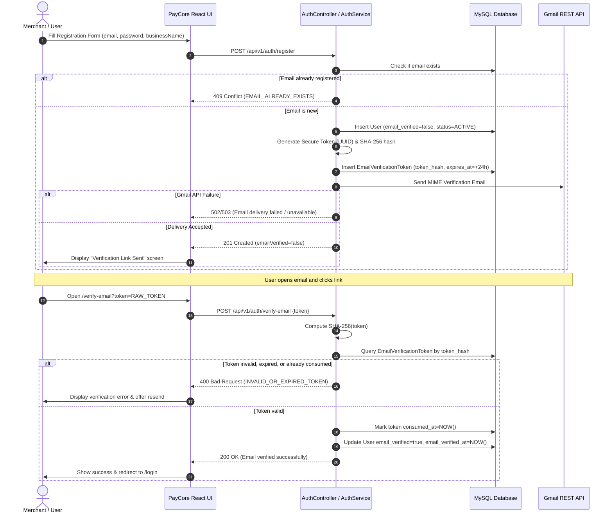
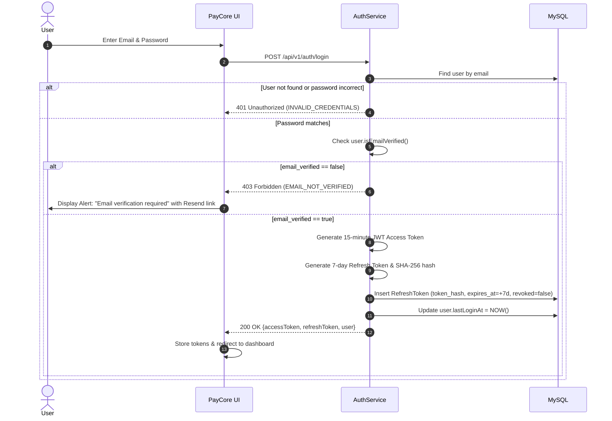

# PayCore — Authentication Flow & Token Lifecycle Architecture

## 1. Overview

In Stage 7.5, PayCore enhances its identity and access layer from simple JWT generation to a production-grade, zero-trust authentication architecture featuring:
1. **Mandatory Email Verification:** Newly registered users cannot access merchant APIs until email ownership is cryptographically verified.
2. **Cryptographic Token Hashing at Rest:** Tokens (verification, password reset, refresh tokens) are hashed using SHA-256 before database persistence.
3. **Dual-Token Architecture:** Short-lived JWT access tokens paired with rotatable, persistent refresh tokens.
4. **Token Rotation & Replay Attack Defense:** Refresh tokens are single-use; reusing an old token triggers automatic session invalidation.
5. **Secure Revocation on Logout:** Server-side refresh token invalidation ensures session termination across distributed systems.

---

## 2. Registration & Email Verification Sequence



---

## 3. Login & Verified-Email Enforcement Sequence



---

## 4. Refresh Token Rotation & Replay Protection

To guard against token theft while maintaining seamless user sessions, PayCore employs **single-use refresh token rotation**:

1. **Client Request:** When the 15-minute access token expires, the client sends:
   ```http
   POST /api/v1/auth/refresh
   Content-Type: application/json

   {
     "refreshToken": "<raw_refresh_token_string>"
   }
   ```
2. **Hash Lookup:** The backend hashes the raw token (`SHA-256`) and checks `refresh_tokens`.
3. **Replay Detection:**
   - If the token was **already revoked** (`revoked = true`), it indicates a potential token compromise or replay attack. The server immediately logs a security incident and revokes all active refresh tokens for the user.
4. **Normal Rotation:**
   - The presented token is marked `revoked = true`, `revoked_at = NOW()`.
   - A new raw refresh token is generated, hashed, and stored:
     - `replaced_by_token_hash = SHA256(newRefreshToken)`
   - A fresh 15-minute JWT and the new refresh token are returned to the client:
   ```json
   {
     "status": "success",
     "data": {
       "accessToken": "eyJhbG...",
       "refreshToken": "new_random_refresh_token...",
       "tokenType": "Bearer",
       "expiresIn": 900
     }
   }
   ```

---

## 5. Logout & Session Termination

When a user initiates logout:
1. The frontend invokes:
   ```http
   POST /api/v1/auth/logout
   Content-Type: application/json

   {
     "refreshToken": "<active_refresh_token>"
   }
   ```
2. The server marks the token as revoked in the database:
   - `revoked = true`
   - `revoked_at = NOW()`
3. The frontend clears all tokens from local storage (`paycore_token`, `paycore_refresh_token`) and redirects to `/login`.
