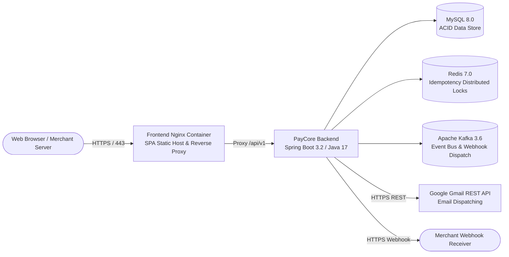

# PayCore — Production Deployment & Operations Guide

## 1. Overview & Architecture

PayCore is engineered as a container-ready modular monolith. It can be deployed using:
1. **Docker Compose:** Ideal for single-node production, staging, and local development.
2. **Kubernetes / Cloud Containers (GCP Cloud Run, AWS ECS, Railway, Render):** Running containerized Backend and Frontend instances backed by managed or containerized MySQL, Redis, and Kafka.



---

## 2. Infrastructure Prerequisites

| Component | Minimum Version | Recommended Resources | Port | Purpose |
|---|---|---|---|---|
| **Java Runtime** | Temurin OpenJDK 17 LTS | 1 vCPU, 1 GB RAM | 8080 | Backend Spring Boot application |
| **Node.js** | 20 LTS | For building Vite frontend | 5173 / 80 | Frontend SPA static bundle |
| **MySQL** | 8.0+ | 1 vCPU, 1 GB RAM, 10 GB SSD | 3306 | Primary relational persistence |
| **Redis** | 7.0+ | 0.5 vCPU, 512 MB RAM | 6379 | Distributed locking & fast cache |
| **Apache Kafka** | 3.6+ (KRaft mode) | 1 vCPU, 1 GB RAM | 9092 | Transactional outbox event bus |

---

## 3. Database Initialization & Production Schema

In production, auto-DDL (`ddl-auto=update` or `create-drop`) is strictly disabled to prevent accidental data loss. Instead, use the production migration script:

```bash
# Apply schema to MySQL database
mysql -h localhost -u paycore_user -p paycore_db < PayCore-Backend/src/main/resources/schema-production.sql
```

The script initializes all tables, constraints, monetary columns (`DECIMAL(19, 4)`), indexes, and the unified view `v_transactions`.

---

## 4. Environment Variables Configuration

Copy `.env.example` to `.env` and set production secrets:

```bash
cp PayCore-Backend/.env.example PayCore-Backend/.env
```

| Variable | Description | Example Production Value |
|---|---|---|
| `SPRING_PROFILES_ACTIVE` | Active Spring profile | `prod` |
| `SERVER_PORT` | HTTP port for backend service | `8080` |
| `DB_URL` | JDBC URL for MySQL instance | `jdbc:mysql://mysql:3306/paycore_db?useSSL=false&serverTimezone=UTC` |
| `DB_USERNAME` | MySQL database user | `paycore_user` |
| `DB_PASSWORD` | MySQL database password | `StrongSecretPassword123!` |
| `REDIS_HOST` | Redis hostname or IP | `redis` |
| `REDIS_PORT` | Redis port | `6379` |
| `KAFKA_BOOTSTRAP_SERVERS`| Kafka broker address | `kafka:29092` |
| `JWT_SECRET` | 256-bit cryptographically secure hex secret | `404E635266556A586E3272357538782F413F4428472B4B6250645367566B5970` |
| `GOOGLE_CLIENT_ID` | OAuth 2.0 Web Client ID | `1234567890-xxx.apps.googleusercontent.com` |
| `GOOGLE_CLIENT_SECRET` | OAuth 2.0 Client Secret | `GOCSPX-xxxxxxxxxxxxxxxx` |
| `GOOGLE_REDIRECT_URI` | Exact OAuth redirect URI registered in Google Console | `https://api.yourdomain.com/api/v1/auth/google/callback` |
| `GOOGLE_REFRESH_TOKEN` | Authorized Gmail offline refresh token | `1//04xxxxxxxxxxxxxxxxxxxxxxxxxxxx` |
| `GOOGLE_SENDER_EMAIL` | Sender Gmail address | `omp27614@gmail.com` |
| `APP_FRONTEND_URL` | Base URL for verification and reset email links | `https://paycore.yourdomain.com` |

---

## 5. Deployment Methods

### Option A: Complete Docker Compose Deployment (Recommended for Single Server)

Start backing infrastructure services:
```bash
cd PayCore-Backend
docker-compose up -d mysql redis kafka
```

Verify service health:
```bash
docker-compose ps
```

Start the complete application stack (Backend + Frontend + MySQL + Redis + Kafka):
```bash
docker-compose --profile full up -d --build
```

### Option B: Bare-Metal / Virtual Machine Deployment

#### 1. Build and Run Backend:
```bash
cd PayCore-Backend
./mvnw clean package -DskipTests
java -jar -Dspring.profiles.active=prod target/paycore-backend-0.0.1-SNAPSHOT.jar
```

#### 2. Build and Serve Frontend:
```bash
cd PayCore-Frontend
npm ci
npm run build
```
Copy contents of `dist/` to your Nginx web root (e.g. `/usr/share/nginx/html`).

---

## 6. Health Checks & Diagnostics

- **Backend Health Check:**
  ```bash
  curl http://localhost:8080/actuator/health
  ```
  Expected output: `{"status":"UP"}`

- **Email Service Status Check:**
  ```bash
  curl http://localhost:8080/api/v1/auth/email-status
  ```
  Expected output: `{"status":"success","data":{"configured":true,"provider":"GMAIL_REST_API",...}}`

- **Frontend Health Check:**
  ```bash
  curl -I http://localhost:5173/
  ```
  Expected output: HTTP 200 OK

---

## 7. Operational Troubleshooting

| Symptom | Probable Cause | Recommended Resolution |
|---|---|---|
| `503 EMAIL_DELIVERY_UNAVAILABLE` | `GOOGLE_REFRESH_TOKEN` or `GOOGLE_CLIENT_ID` not set | Query `/api/v1/auth/google/oauth-url`, authorize with `omp27614@gmail.com`, set the returned token in `GOOGLE_REFRESH_TOKEN`, and restart backend. |
| `502 EMAIL_DELIVERY_FAILED` | Google revoked OAuth consent or rate-limited | Verify that `omp27614@gmail.com` is added under Test Users in Google Cloud Console. Re-generate refresh token. |
| `409 IDEMPOTENCY_CONFLICT` | Replaying same `Idempotency-Key` with altered payload | Ensure clients regenerate `Idempotency-Key` when mutating request parameters. |
| Database connection refused | MySQL container not yet healthy | Verify `docker-compose ps`. Ensure `depends_on` with `condition: service_healthy` is respected. |
| SPA 404 on page refresh | Nginx missing fallback rule | Ensure `nginx.conf` contains `try_files $uri $uri/ /index.html;`. |
