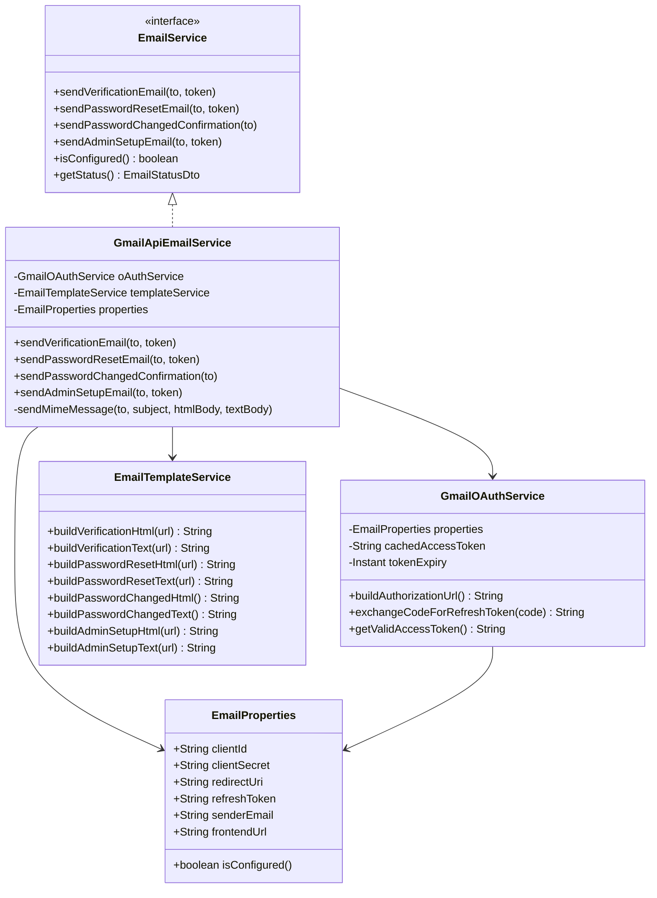

# PayCore — Real Gmail API Email Integration Architecture

## 1. Overview & Architectural Principles

In Stage 7.5, PayCore integrates **real email delivery** powered by Google's official **Gmail REST API** and **OAuth 2.0 authorization**. Email communications are essential for mission-critical security workflows:
- User email verification upon merchant onboarding.
- Password recovery links and account takeover defense.
- Real-time alerts on password change events.
- Zero-trust initial platform administrator provisioning.

### Critical Design Decisions
1. **Zero Fake Delivery / Fail-Fast Transparency:**
   The application strictly avoids mock or simulated email delivery in production or staging. If Google OAuth credentials are missing, malformed, or rejected by Google, the system returns explicit, actionable errors (`503 EmailDeliveryUnavailableException` or `502 EmailDeliveryFailedException`). The UI will never claim an email was dispatched if Google's servers did not accept it.
2. **Offline Refresh Token Authorization:**
   Because backend background processes (such as user registration or password reset) cannot prompt a human for an interactive login, the service utilizes Google OAuth 2.0 offline access. A long-lived `refresh_token` is exchanged for temporary Google access tokens cached in memory.
3. **No Gmail Passwords or App Passwords:**
   Personal Google account passwords or legacy App Passwords are never stored, requested, or processed. Authentication adheres strictly to standard Google OAuth 2.0 client credentials and bearer tokens.
4. **MIME Construction & URL-Safe Base64 Encoding:**
   Emails are structured as multipart MIME messages with both HTML and plain-text alternatives using Jakarta Mail (`angus-mail`), base64url-encoded, and sent through the official `google-api-services-gmail` SDK (`Users.Messages.Send`).

---

## 2. Module Components & Class Diagram

The email module is encapsulated within `com.paycore.email`:

### Class Responsibilities
- **`EmailProperties`**: Spring `@ConfigurationProperties(prefix = "paycore.email")` mapping environment variables:
  - `GOOGLE_CLIENT_ID` (`paycore.email.client-id`)
  - `GOOGLE_CLIENT_SECRET` (`paycore.email.client-secret`)
  - `GOOGLE_REDIRECT_URI` (`paycore.email.redirect-uri`)
  - `GOOGLE_REFRESH_TOKEN` (`paycore.email.refresh-token`)
  - `GOOGLE_SENDER_EMAIL` (`paycore.email.sender-email`, default: `omp27614@gmail.com`)
  - `APP_FRONTEND_URL` (`paycore.email.frontend-url`, default: `http://localhost:5173`)
- **`GmailOAuthService`**: 
  - Generates the authorization URL with scope `https://www.googleapis.com/auth/gmail.send` and `access_type=offline`.
  - Exchanges one-time authorization code for the permanent `refresh_token`.
  - Caches access tokens with an internal buffer (5-minute expiration safety margin).
- **`GmailApiEmailService`**:
  - Implements `EmailService`.
  - Builds RFC 2822 MIME messages using `jakarta.mail.internet.MimeMessage`.
  - Encodes the message with RFC 4648 URL-safe Base64.
  - Dispatches message to `https://gmail.googleapis.com/gmail/v1/users/me/messages/send`.
- **`EmailTemplateService`**:
  - Generates modern, responsive HTML templates styled in PayCore brand colors (Deep Navy `#0F172A`, Electric Blue `#2563EB`, Surface Gray `#F8FAFC`).
  - Generates clean, accessible plain-text fallback alternatives for mail clients that disable HTML.

---

## 3. Dispatched Email Types

| Type | Purpose | Primary CTA | Expiration |
|---|---|---|---|
| **Verification Email** | Confirms merchant account ownership upon registration. | Verify Email Address (`/verify-email?token=...`) | 24 Hours |
| **Password Reset** | Initiates secure self-service password recovery. | Reset Password (`/reset-password?token=...`) | 1 Hour |
| **Password Changed** | Real-time security alert notifying user of password update. | Informational (Contact Support if unauthorized) | Immediate |
| **Admin Setup** | Authorizes initial platform administrator onboarding. | Complete Administrator Setup (`/admin-setup?token=...`) | 24 Hours |

---

## 4. Error Handling & Fail-Fast Guarantees

When email delivery fails, the application strictly reports transparent diagnostics:

| Condition | HTTP Status | Error Code | Behavior |
|---|---|---|---|
| OAuth credentials or refresh token missing | `503 Service Unavailable` | `EMAIL_DELIVERY_UNAVAILABLE` | Informs user/admin that email delivery is not configured on the server. Does not pretend sending succeeded. |
| Google OAuth access token refresh fails (400/401 from Google) | `502 Bad Gateway` | `EMAIL_DELIVERY_FAILED` | Indicates authorization revocation or invalid client secret. |
| Google Gmail API quota or rate-limit exceeded (429/500 from Google) | `502 Bad Gateway` | `EMAIL_DELIVERY_FAILED` | Captures Google error message and logs without leaking tokens. |
| Invalid recipient address or delivery rejection | `502 Bad Gateway` | `EMAIL_DELIVERY_FAILED` | Rejects transaction with explanation. |

---

## 5. Security & Anti-Enumeration Protections

1. **Anti-Enumeration Responses:**
   - Calls to `/api/v1/auth/forgot-password` and `/api/v1/auth/resend-verification` return a uniform HTTP 200 generic response regardless of whether the email exists in the database.
   - Timing differences are mitigated by generating token hashes before lookup resolution.
2. **Hash-at-Rest:**
   - Raw tokens are never persisted. Only the SHA-256 digest `SHA256(rawToken)` is stored in the database.
3. **Single-Use Enforcement:**
   - Consuming a token stamps `consumed_at = NOW()`. Any subsequent submission is rejected with `INVALID_OR_EXPIRED_TOKEN`.
