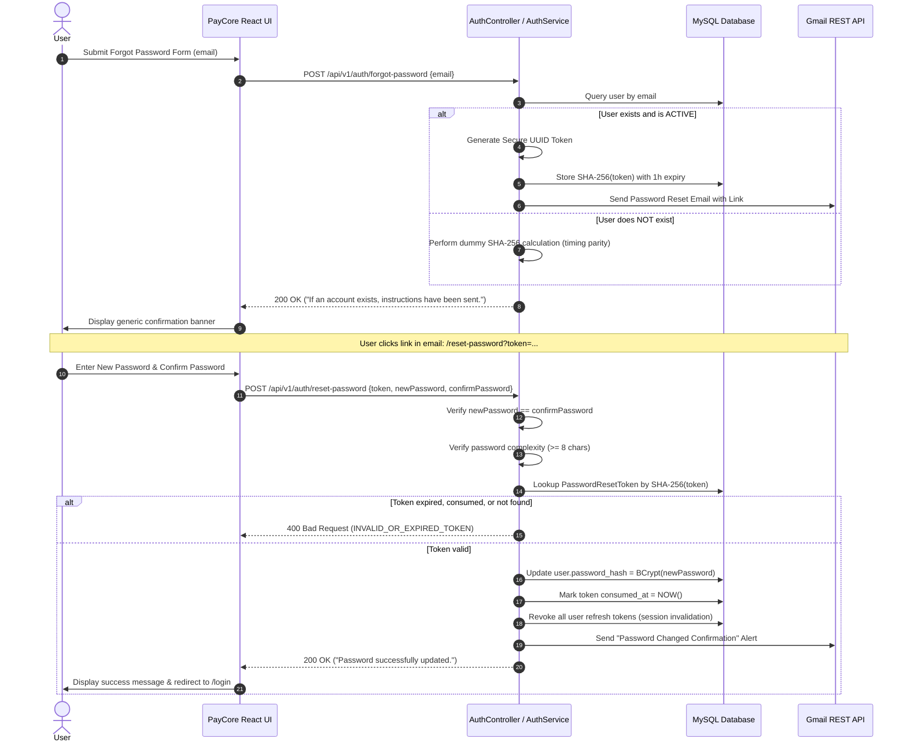

# PayCore — Password Recovery & Session Invalidation Architecture

## 1. Overview & Threat Model

Password recovery is one of the highest-risk attack vectors in financial and payment processing systems. Weak recovery mechanisms allow account enumeration, brute-force link discovery, and session hijack retention.

PayCore implements an enterprise-grade password reset protocol designed to mitigate:
- **Account Enumeration:** Attackers cannot discover valid accounts by scraping error messages.
- **Token Tampering / Database Breach Risk:** Reset tokens are never stored in plaintext; only SHA-256 hashes are persisted.
- **Token Reuse:** Tokens are strictly single-use and expire within 60 minutes.
- **Ghost Sessions:** Completing a password reset immediately invalidates all active sessions and refresh tokens across all devices.
- **Silent Account Takeover:** Real-time confirmation emails notify the account owner when a password change occurs.

---

## 2. Password Recovery Sequence Diagram



---

## 3. Key Security Controls

### 3.1 Generic Anti-Enumeration Response
The endpoint `/api/v1/auth/forgot-password` returns the exact same HTTP 200 payload regardless of whether the user exists or not:
```json
{
  "status": "success",
  "message": "If an account exists with this email address, a password reset link has been dispatched."
}
```
No information is leaked to unauthorized callers regarding account existence.

### 3.2 Token Hashing & Expiration
- **Raw Token:** Cryptographically secure 32-character UUID v4 token transmitted only via URL query parameters in the email.
- **Stored Token:** Database column `token_hash` stores `Hex(SHA-256(rawToken))`.
- **Validity Window:** Exactly 60 minutes (`Instant.now().plus(1, ChronoUnit.HOURS)`).
- **Consumption:** Once used, `consumed_at` is updated to the current timestamp. Attempting to submit the token again results in `400 Bad Request`.

### 3.3 Universal Session Invalidation
When an account password is reset (whether by the genuine user or as a remediation after a compromise), all existing sessions must be terminated.
In PayCore:
1. All `RefreshToken` entities associated with the user ID are marked `revoked = true` and `revoked_at = NOW()`.
2. Existing short-lived access JWTs expire naturally within 15 minutes, and any attempt to use an active refresh token to obtain new access tokens is rejected.

### 3.4 Immediate Security Alert Email
Upon successful password modification, the backend immediately calls `emailService.sendPasswordChangedConfirmation(user.getEmail())`. This sends an alert informing the user of the timestamp and advises them to contact security immediately if they did not initiate the change.
