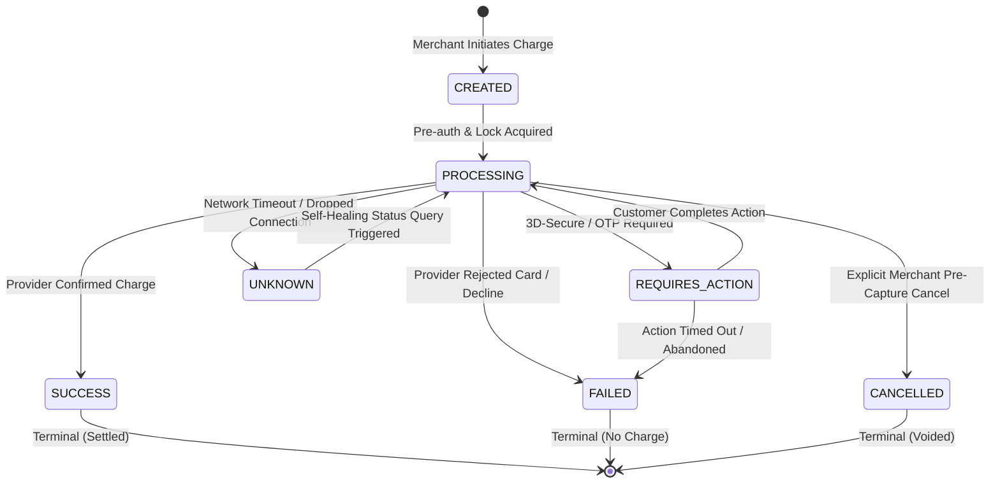
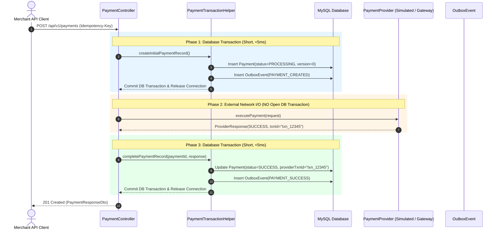
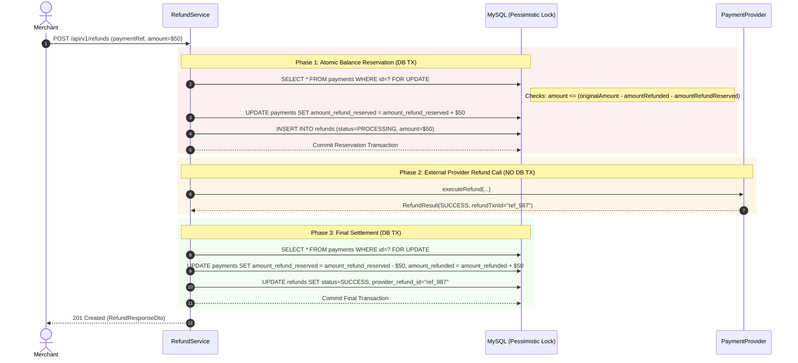

# PayCore — Payment & Transaction Lifecycle Specification

## 1. Complete Payment State Machine

PayCore enforces deterministic state transitions across payments. No entity can transition directly from terminal states (`SUCCESS`, `FAILED`, `CANCELLED`) to any other state.

### Valid Transition Matrix

| Current State | Target State | Trigger / Condition |
|---|---|---|
| `CREATED` | `PROCESSING` | Payment record initialized, idempotency validated, ready for provider dispatch. |
| `PROCESSING` | `SUCCESS` | Downstream provider returned successful capture confirmation. |
| `PROCESSING` | `FAILED` | Provider returned explicit decline or fraud rule violation. |
| `PROCESSING` | `REQUIRES_ACTION` | Downstream bank requires customer challenge (3DS redirect URL returned). |
| `PROCESSING` | `UNKNOWN` | Gateway socket dropped, connection timeout, or 504 Gateway Timeout. |
| `REQUIRES_ACTION` | `PROCESSING` | Webhook or customer return callback received indicating completion. |
| `REQUIRES_ACTION` | `FAILED` | Customer failed challenge or challenge expired. |
| `UNKNOWN` | `PROCESSING` | Scheduled reconciliation or merchant verify request polls provider status. |
| `CREATED` / `PROCESSING` | `CANCELLED` | Explicit cancellation requested prior to downstream settlement. |

---

## 2. Zero-DB-Transaction Network I/O Guarantee

In high-volume payment processing, holding an open database transaction while making an external network call causes connection pool exhaustion and database lock starvation.

PayCore guarantees **zero open database transactions during external provider network I/O**:

---

## 3. Distributed Idempotency Protocol

To prevent accidental double-charging when clients retry due to network hiccups, PayCore implements a 3-layer idempotency defense:

1. **Redis Fast-Lock Coordination:**
   - Atomic distributed lock on `lock:idempotency:{merchantId}:{idempotencyKey}` with a 30-second TTL.
   - Prevents simultaneous requests with the exact same key from racing in memory.
2. **Canonical Payload Fingerprinting:**
   - Generates SHA-256 digest of normalized payload: `amount + "|" + currency + "|" + paymentMethod + "|" + customerEmail + "|" + description`.
   - If an existing record is found with the same `(merchant_id, idempotency_key)`:
     - If payload fingerprint matches: returns cached result immediately with `Idempotent-Replay: true` header. No second provider charge occurs.
     - If payload fingerprint differs: rejects immediately with HTTP `409 Conflict` (`IDEMPOTENCY_CONFLICT`).
3. **Database Uniqueness Constraint:**
   - Composite unique constraint `uk_merchant_idempotency_key (merchant_id, idempotency_key)` in MySQL acts as the authoritative final barrier even if Redis is unavailable.

---

## 4. Refund Balance Reservations & Lifecycle

A payment can be refunded partially or fully. To prevent concurrent race conditions where multiple simultaneous refunds exceed the original settled amount:

**Timeout Protection:** If the external provider drops the connection during Phase 2, the `$50` remains in `amount_refund_reserved` and the refund is marked `UNKNOWN`. It cannot be double-refunded while in this unconfirmed state until reconciled or authoritatively verified.

---

## 5. Event-Driven Webhook Dispatching (Outbox + Kafka)

1. Business operations update payments/refunds and insert domain events into `outbox_events` in the **same database transaction**.
2. `OutboxPublisherScheduler` polls unpublished outbox records and publishes messages to partitioned Kafka topics (`paycore.payment.events`, `paycore.refund.events`).
3. Partition key is set to entity reference (`paymentReference`), guaranteeing per-entity message ordering.
4. Kafka consumers write events to `inbox_events` with unique constraint `(event_id, consumer_name)` to guarantee idempotent execution.
5. `WebhookDeliveryWorker` computes HMAC-SHA256 signatures (`X-PayCore-Signature: t=timestamp,v1=signature`) and delivers payloads with exponential backoff retries (`5s, 30s, 120s, 900s, 3600s`). Exhausted attempts route to dead-letter queues.
