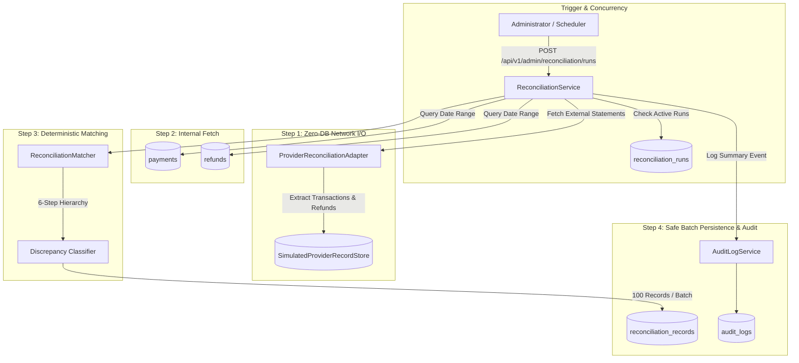

# PayCore — Financial Reconciliation Design

> [!IMPORTANT]
> **SIMULATED SETTLEMENT DISCLAIMER:**  
> PayCore features a simulated payment provider architecture for testing and demonstration. The settlement ledgers, clearing records, and provider transactions simulated in `SimulatedProviderRecordStore` represent simulated data and do **not** represent live banking operations, real financial transactions, Federal Reserve ACH files, or Visa/Mastercard interchange clearing.

---

## 1. Overview & Problem Statement

In mission-critical financial infrastructure, internal database transaction records cannot be presumed infallible. Distributed outages, network timeouts, webhook dropouts, delayed bank clearing, and provider processing errors inevitably lead to ledger divergences.

Financial reconciliation is the systematic, deterministic comparison between:
1. **Internal PayCore Ledger:** The authoritative internal system of record (`payments` and `refunds` tables).
2. **External Provider Settlement Reports:** Independent daily settlement batches, clearing statements, and transaction journals generated by acquiring banks or payment networks.

Crucially, **reconciliation is not simply querying the internal database twice under different names**. An independent provider statement store (`SimulatedProviderRecordStore`) models the external clearing house ledger, allowing PayCore to identify genuine financial discrepancies.

---

## 2. Architecture & Components

### Component Roles

1. **`ProviderReconciliationAdapter`:**
   Extensible interface defining contract for fetching external statements (`fetchTransactionRecords`, `fetchRefundRecords`).
2. **`SimulatedProviderRecordStore`:**
   Thread-safe, independent provider-side record store maintaining simulated bank statement journals, separate from PayCore's MySQL database.
3. **`ReconciliationMatcher`:**
   Pure, deterministic matching engine implementing the 6-step reconciliation hierarchy without side effects or database mutation.
4. **`ReconciliationService`:**
   Orchestrates run lifecycle, enforces concurrency locks, batches record persistence, and audits discrepancy resolutions.

---

## 3. Strict 6-Step Matching Hierarchy

Reconciliation matching follows an immutable, deterministic order. Discrepancies are categorized with granular, actionable classifications:

| Step | Rule | Discrepancy Classification | Assigned Status | Action Required |
|---|---|---|---|---|
| **1** | Duplicate Provider Records | `DUPLICATE_PROVIDER_RECORD` | `REVIEW_REQUIRED` | Flagged: Provider recorded multiple settlements for a single internal reference. |
| **2** | Existence Check | `MISSING_PROVIDER` / `MISSING_INTERNAL` | `UNMATCHED` | Unmatched: Record exists on only one side of the ledger. |
| **3** | Exact Amount Verification | `AMOUNT_MISMATCH` | `REVIEW_REQUIRED` | Flagged: Internal amount != Provider amount using exact `BigDecimal` scale comparison. |
| **4** | Currency Code Verification | `CURRENCY_MISMATCH` | `REVIEW_REQUIRED` | Flagged: ISO 4217 currency codes do not match identically. |
| **5** | Preserving UNKNOWN Outcomes | `UNKNOWN_OUTCOME` | `REVIEW_REQUIRED` | Flagged: System outcome was uncertain; **never guessed or auto-converted to SUCCESS/FAILED**. |
| **6** | Explicit Status Equivalence | `STATUS_MISMATCH` | `REVIEW_REQUIRED` | Flagged: Statuses diverge (e.g., internal `FAILED` but provider `SUCCESS`). |
| **—** | All 6 Checks Pass | `MATCHED` | `MATCHED` | Fully reconciled: Clean transaction. |

---

## 4. Zero-DB Network I/O Principle

To prevent database connection starvation during statement retrieval:
- Provider statement fetching occurs **outside** any active database transaction.
- Statement records are accumulated in memory.
- Internal records are queried using clean read-only criteria.
- Persisting reconciliation records executes in bounded **100-record batches**, preventing locks on large statement files.

---

## 5. Manual Discrepancy Resolution Protocol

Under no circumstance does resolving a discrepancy silently mutate, overwrite, or delete historical `payments` or `refunds` rows.

### Resolution Rules:
1. Only records in `REVIEW_REQUIRED` or `UNMATCHED` can be resolved. Clean `MATCHED` records cannot be altered.
2. The resolving administrator must provide:
   - A recognized reason code (`FEE_ADJUSTMENT`, `REFUND_TIMING_DELAY`, `DUPLICATE_SETTLED`, `MANUAL_CORRECTION`, `PROVIDER_UNAVAILABLE`, `OTHER`).
   - Detailed justification notes.
3. The reconciliation record's status transitions to `RESOLVED`, recording `resolved_by` and `resolved_at`.
4. An immutable audit log entry is immediately generated capturing before/after states and justification.
