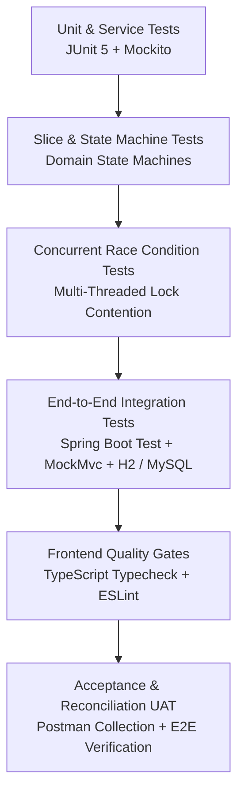

# PayCore — Comprehensive Testing Guide

## 1. Overview & Test Architecture

PayCore enforces an exhaustive, multi-tier testing strategy ensuring payment correctness, non-repudiation, zero double-charges, deterministic state transitions, and real email verification.



---

## 2. Backend Automated Test Suite

### 2.1 Test Categories & Locations
The backend test suite is located in `src/test/java/com/paycore`:

| Test Class | Focus & Verification Scope | Test Type |
|---|---|---|
| `PaymentStateMachineTest` | Validates all valid & invalid transitions for payment lifecycle (`CREATED`, `PROCESSING`, `SUCCESS`, `FAILED`, `REQUIRES_ACTION`, `UNKNOWN`, `CANCELLED`). | Unit |
| `RefundStateMachineTest` | Tests refund state transitions, terminal state immutability, and retry pathways. | Unit |
| `PaymentServiceTest` | Mocked unit tests for payment creation, provider interaction, and status retrieval. | Unit / Mockito |
| `RefundServiceTest` | Tests refund amount reservation, balance decrements, and over-refund rejection. | Unit / Mockito |
| `AuthServiceTest` | 16 tests covering registration, SHA-256 token hashing, unverified login blocks, refresh token rotation, replay detection, password recovery, and admin onboarding. | Unit / Mockito |
| `TokenCleanupSchedulerTest` | Validates daily purging of expired/consumed tokens across all token repositories. | Unit / Mockito |
| `GmailApiEmailServiceTest` | Tests Gmail configuration detection, missing credential rejection, token refresh failures, and MIME dispatching. | Unit / Mockito |
| `PaymentConcurrencyIntegrationTest` | Multi-threaded tests executing simultaneous charges with identical `Idempotency-Key` to verify zero double-charges. | Concurrency Integration |
| `RefundConcurrencyIntegrationTest` | 10 concurrent threads racing to refund a single payment; proves balance reservations prevent over-refunding. | Concurrency Integration |
| `PaymentIdempotencyIntegrationTest` | Tests 6 canonical idempotency scenarios (first request, replay, payload conflict, active in-flight, timeout recovery, expiration). | Integration / MockMvc |
| `AuthIntegrationTest` | Full HTTP integration verifying registration, unverified email 403, email verification, login, refresh rotation, and admin onboarding. | Integration / MockMvc |
| `WebhookDeliveryIntegrationTest` | Tests transactional outbox publishing, Kafka event dispatching, HMAC-SHA256 signature generation, and exponential backoff retry. | Integration / MockMvc |
| `ReconciliationIntegrationTest` | Compares internal records against independent simulated provider statements; verifies discrepancy detection and resolution. | Integration / MockMvc |
| `AuditLogServiceTest` | Verifies append-only audit logging and sensitive data sanitization (masking card numbers, passwords, tokens). | Unit |

### 2.2 Test Execution Commands
All commands run from the `PayCore-Backend` root directory:

```bash
# Run the entire backend test suite
./mvnw clean test

# Run a specific unit test class
./mvnw test -Dtest=AuthServiceTest

# Run all integration tests
./mvnw test -Dtest=*IntegrationTest

# Run with full Surefire report output
./mvnw test -Dsurefire.useFile=false

# Full compilation, test verification, and packaged JAR build
./mvnw clean verify -DskipTests=false
```

---

## 3. Frontend Quality Gates & Testing

Frontend verification is located in `PayCore-Frontend`:

### 3.1 Verification Commands
All commands run from the `PayCore-Frontend` root directory:

```bash
# 1. Type Check (TypeScript compiler without emitting JS)
npm run typecheck

# 2. Linting (Zero warnings allowed)
npm run lint

# 3. Production Vite Bundle Build
npm run build
```

---

## 4. Manual Postman & E2E Acceptance Verification

1. Import `PayCore.postman_collection.json` and `PayCore.postman_environment.json` from `PayCore-Backend/postman/` into Postman.
2. Select the **PayCore Local Development Environment**.
3. Execute tests in folder sequence:
   - **1. Authentication & Email Identity:** Test registration, verify email, login, refresh, logout, password recovery.
   - **2. Merchants & API Keys:** Generate test API credentials.
   - **3. Payment Engine & Idempotency:** Execute idempotent payment requests and verify duplicate rejections.
   - **4. Refunds:** Execute partial refunds and verify balance decrement.
   - **5. Unified Transaction History:** Verify single ledger query for payments and refunds.
   - **6. Webhooks:** Verify HMAC-signed dispatch and delivery logs.
   - **7. Reconciliation & Audit:** Trigger reconciliation run and inspect discrepancies.
   - **8. Admin Governance:** Review real database metrics on admin dashboard.
